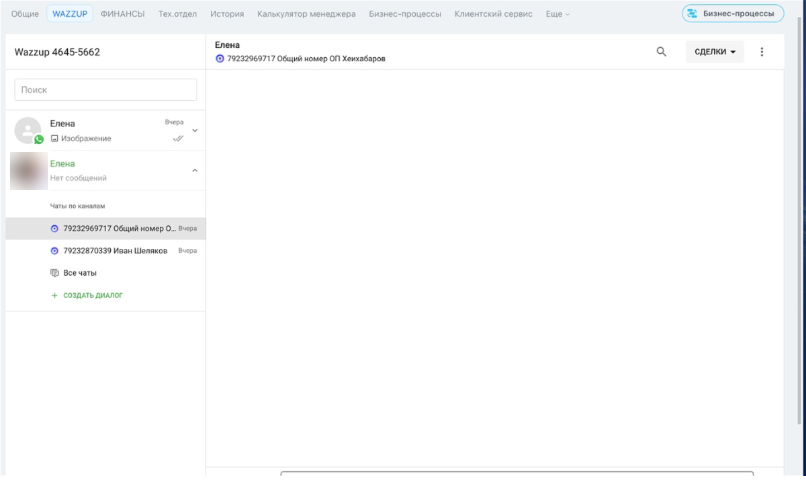
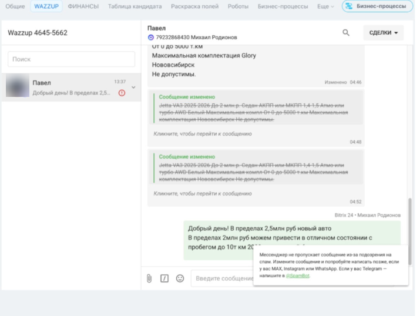
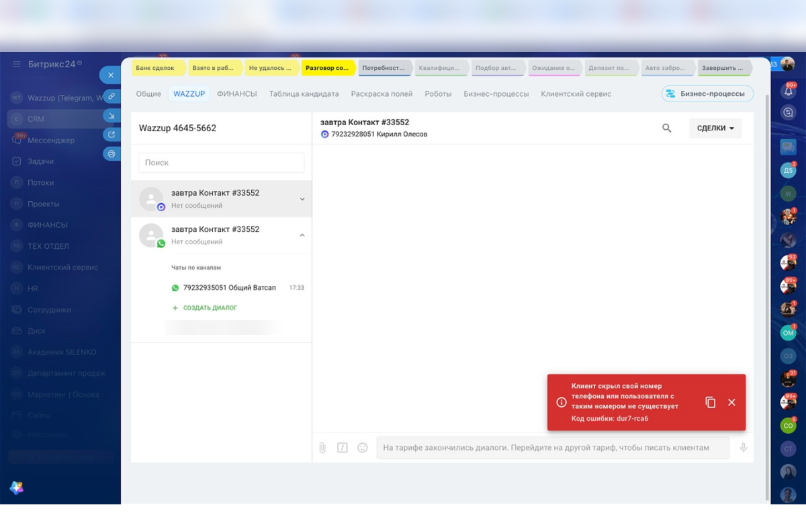
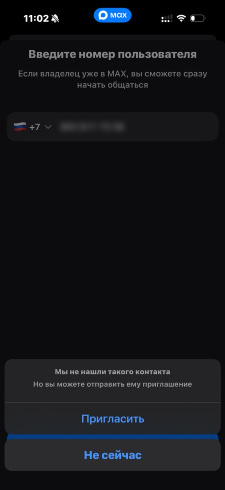
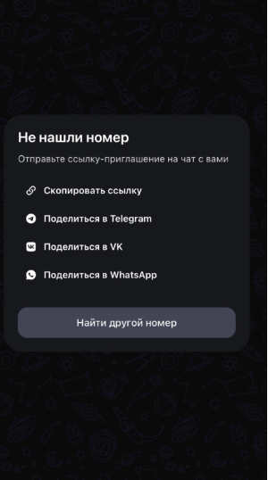
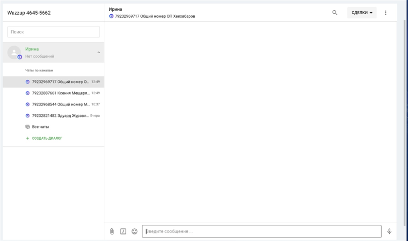
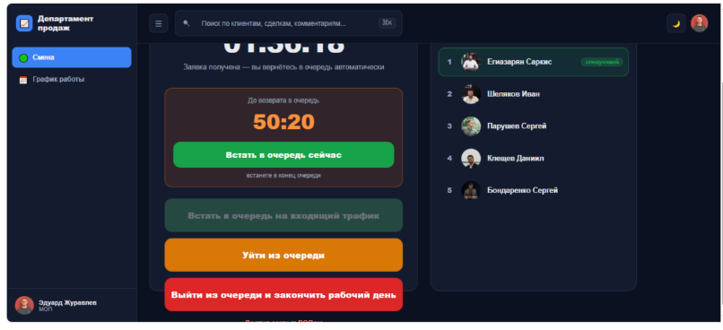
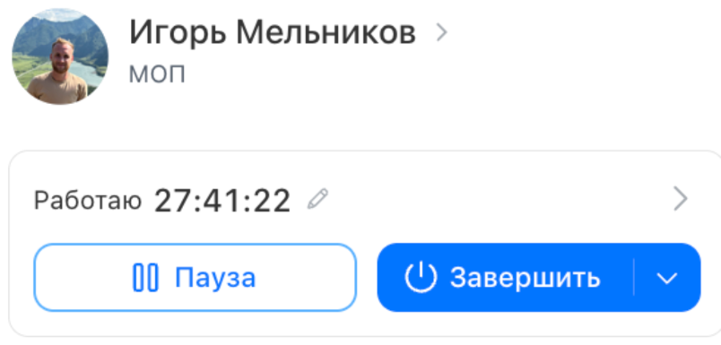
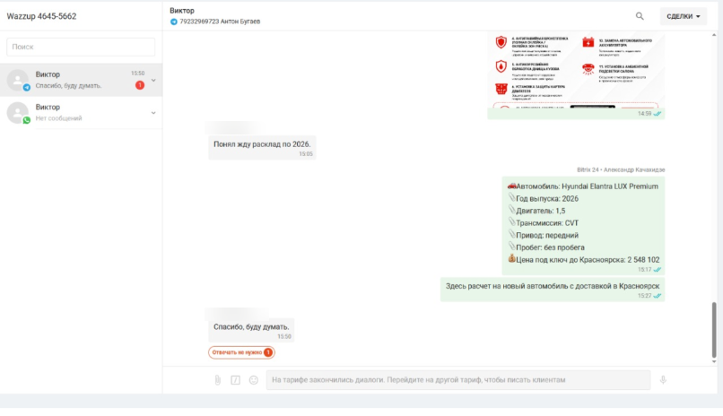
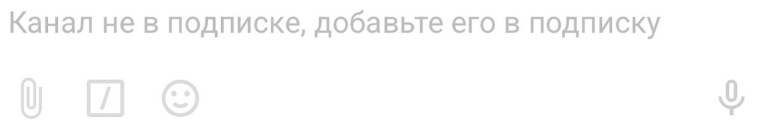

=== start | Главная
# Памятка менеджера: Wazzup и CRM

Большинство вопросов в чате «срм/маркетинг обращения/дубли» менеджер решает сам за 1–2 минуты. Найди свою ситуацию в таблице и открой раздел: там шаги, скриншоты и примеры из чата.

## Найди свою ситуацию

| Ситуация | Кто решает | Раздел |
| --- | --- | --- |
| MAX: «не пропускает сообщение из-за подозрения на спам» | Сам | [MAX не отправляет](#max) |
| «Клиент скрыл свой номер», «Мы не нашли такого контакта» | Сам | [MAX не отправляет](#max) |
| Не получается написать первым в Telegram, на номере нет WhatsApp | Сам | [Telegram и WhatsApp](#tg) |
| Пропал чат с клиентом, не создаётся диалог | Сам | [Чаты и приложение](#chats) |
| Выкинуло из приложения Wazzup, не приходит СМС | Сам | [Чаты и приложение](#chats) |
| Видеоосмотр не отправляется | Сам | [Файлы и видео](#files) |
| В лиде нет номера, «вызов запрещён» | Сам | [Лид без номера](#nonumber) |
| «Заявку не оставлял», ребёнок, реклама, вакансия | Сам | [Нецелевые и спам](#spam) |
| Дубль сделки | Сам, если оригинал доступен | [Дубли](#dupes) |
| Забыл завершить смену, вопросы по очереди | Сам | [Звонки, очередь, смена](#calls) |
| Взял входящий, а сделки нет; чей клиент | Чат | [Звонки, очередь, смена](#calls) |
| «Закончились диалоги», «Канал не в подписке», номер в бане, нет прав | Администратор | [Только администратор](#admin) |

## Ещё пригодится

- Что такое Wazzup, где чаты, что значит статус канала: [Wazzup: каналы и статусы](#wazzup)
- Как написать в чат, чтобы ответили быстро, и кого отмечать: [Как писать в чат](#howto)

## Три правила

1. Сначала шаги из раздела, потом чат.
2. В чат одно сообщение: ссылка на сделку + что случилось + скриншот.
3. Спам и нецелевые закрываешь сам, в чат не пишешь.

=== wazzup | 1. Wazzup: каналы и статусы
# Wazzup: где чаты, каналы и статусы

Wazzup соединяет наши номера в MAX, Telegram и WhatsApp с Битрикс24. Вся переписка с клиентом идёт через него и сохраняется в сделке.

## Где чаты

- **Все твои чаты:** кнопка Wazzup на левой панели Битрикс24.
- **Чат с одним клиентом:** открой сделку → вкладка WAZZUP вверху карточки.
- **На телефоне:** приложение Wazzup, там те же чаты.



Слева под именем клиента список «Чаты по каналам»: с каких наших номеров с ним уже переписывались. Значок у аватарки показывает мессенджер: синий кружок MAX, зелёный WhatsApp, голубой самолётик Telegram.

## Каналы и номера

- **Канал** = один наш аккаунт в мессенджере. Например, MAX на твоём рабочем номере или «Общий Ватсап».
- **Свой номер** есть у каждого менеджера. Пиши клиентам с него.
- **Общие номера** («Общий номер ОП», «Общий Ватсап») для случаев, когда твой номер в блоке или у клиента нет другого мессенджера. Доступ к ним даёт администратор.
- **Несколько номеров:** новый чат создаётся с приоритетного. Нужен другой — «Создать диалог» (раздел «Чаты и приложение»).
- В Wazzup нет «непрочитанных», есть «неотвеченные». Диалог висит сверху, пока ты не ответишь или не нажмёшь «Отвечать не нужно».

## Статус канала: чей это вопрос

| Что видишь | Что значит | Кто решает |
| --- | --- | --- |
| Активен | Всё работает. Отправить можно только в этом статусе | — |
| Подождите минутку | Временный статус | Сам: подожди 2–3 минуты |
| Не авторизирован | Аккаунт разлогинило, в MAX так бывает при постоянном бане | Администратор |
| Открыт в другом месте | Номер подключён ещё где-то | Администратор |
| Не оплачена подписка / Канал не в подписке | Канал выключен до оплаты или добавления в подписку | Администратор |
| На тарифе закончились диалоги | Нельзя начать новый диалог до смены тарифа или нового месяца | Администратор |
| Заблокирован | Техническая причина на стороне Wazzup | Администратор |

Источники: [Статусы каналов](https://wazzup24.ru/help/how-to-use/channels-statuses-ru/), [Где найти чаты Wazzup в Битрикс24](https://wazzup24.ru/help/bitrix24/wazzup-chats-in-bitrix24-ru/), [Как устроены чаты Wazzup](https://wazzup24.ru/help/how-to-use/kak-ustroeny-chaty-wazzup/).

=== max | 2. MAX не отправляет
# MAX: сообщение не уходит

Ошибка про спам не всегда означает бан. Чаще всего клиент скрыл номер или у него нет нас в контактах, и это решается без администратора.

## Как выглядит

**Ошибка 1.** «Мессенджер не пропускает сообщение из-за подозрения на спам», у чата красный восклицательный знак.



**Ошибка 2.** «Клиент скрыл свой номер телефона или пользователя с таким номером не существует» (красная плашка справа внизу). Это не поломка, а настройки клиента. Надпись в поле ввода про тариф — отдельная проблема, она в разделе «Только администратор».



## Сделай сам, по порядку

1. **Проверь, есть ли клиент в MAX.** В приложении MAX на телефоне нажми «Найти по номеру» и введи номер клиента. «Мы не нашли такого контакта» или «Не нашли номер» = клиент скрыл номер или его нет в MAX. Администратор тут не поможет, сразу к шагу 5.
2. **Добавь клиента в контакты** в самом MAX и напиши снова.
3. **Поправь текст и отправь чуть позже.** Одинаковые сообщения подряд чаще улетают в спам.
4. **Напиши прямо из приложения MAX** на телефоне.
5. **Не вышло:** попроси клиента написать первым, открыть номер для всех или дать другой номер с мессенджером. Сделай это звонком или в Telegram/WhatsApp. На входящее сообщение ответить можно даже с номера во временном бане.

**Пример из чата (29.10).** Менеджер не мог написать клиенту с общего номера. Арсений проверил номер в своём MAX и ответил: «Номер работает. Проблема в том, что клиент скрыл свой номер». Вот что он увидел:





## Как понять, что твой номер в бане

- **Временный бан:** поддержка MAX пишет об этом в самом мессенджере. Новым контактам написать нельзя, отвечать тем, кто написал сам или сохранил твой номер, можно. Снимается сам, срок не сообщают.
- **Постоянный бан:** выкидывает из MAX, при входе «Пользователь заблокирован или удалён», в Wazzup статус «Не авторизирован».
- **В обоих случаях** пиши администратору, он выдаст общий номер.

## Чтобы твой номер не забанили

- Не шли много одинаковых сообщений новым контактам за раз. Пиши лично, с именем и по делу.
- Клиент просит не писать — не пиши. Жалоба на спам ведёт к бану, а каждый следующий бан длиннее.
- Не пиши клиенту с чужих номеров без нужды: ему это может показаться мошенничеством.

## Пиши в чат, если

- клиент находится в MAX по номеру, а через Wazzup всё равно не уходит;
- спам-ошибка у тебя с любыми клиентами, даже со старыми (твой номер в бане);
- тебя выкинуло из MAX или статус «Не авторизирован».

Источник: [Баны в MAX: причины и решения](https://wazzup24.ru/help/how-to-use/max-ban/) и ответы Арсения в чате за 29.10.

=== tg | 3. Telegram и WhatsApp
# Telegram и WhatsApp: как писать первым

В Telegram пиши первым по юзернейму, а не по номеру. За юзернейм Telegram не банит, а за частые новые чаты по номеру банит.

## Написать первым из сделки

1. В карточке контакта заполни номер или юзернейм. Юзернейм Telegram идёт в поле **TelegramUsername_WZ** через @, например @ivan_ivanov.
2. Открой вкладку WAZZUP в сделке.
3. Чат создастся с твоего приоритетного номера. Нужен другой канал или номер — «Создать диалог», раздел «Чаты и приложение».

## Правила против бана в Telegram

- Новым клиентам по номеру пиши **не чаще одного раза в 3 минуты**. Wazzup проверял на себе: больше 14 новых чатов по номеру за 3 минуты = бан на неделю.
- На нас пожаловались как на спам = бан от суток. Повторные жалобы = дольше, потом навсегда.
- Во временном бане нельзя писать первым по номеру, но можно отвечать и писать по юзернейму. Проверить бан: напиши боту @SpamBot с этого аккаунта.

## Клиент не находится

| Что видишь | Причина | Что делать |
| --- | --- | --- |
| WhatsApp: такого номера нет | На номере клиента нет WhatsApp | Пробуй Telegram и MAX или звони |
| Telegram не ищет по номеру | Клиент скрыл номер в настройках | Найди его юзернейм в переписке открытой линии или спроси звонком |
| Везде закрыто | Ни WhatsApp, ни Telegram, ни MAX на номере | Попроси клиента написать первым или дать номер с мессенджером |
| Клиент просит почту | — | Корпоративная почта: sales@silenkoautocratia.ru |

**Пример из чата (29.10).** Менеджер не мог связаться ни в MAX, ни в Telegram, ни в WhatsApp. Ответ Арсения: «У клиента нет ни ТГ, ни Макса, попросите его написать вам либо запросите актуальный номер с мессенджерами». Администратор такое не чинит: это настройки клиента.

## Пиши в чат, если

- «На тарифе закончились диалоги» или «Канал не в подписке» — см. раздел «Только администратор»;
- твой Telegram в бане и нужен другой номер;
- нужен доступ к общему WhatsApp.

Источники: [Как написать первым из Битрикс24](https://wazzup24.ru/help/bitrix24/kak-napisat-pervym-v-whatsapp-i-telegram-iz-b24/), [Как избежать блокировки в Telegram](https://wazzup24.ru/help/how-to-use/kak-izbezhat-blokirovki-v-telegram/).

=== chats | 4. Чаты и приложение
# Чат пропал, не создаётся, выкинуло из приложения

Пропавший чат обычно возвращается сам, стоит написать клиенту. Администратор нужен, только если пропали почти все чаты или нужен доступ к чужому номеру.

## Пропал чат с клиентом

1. **Напиши клиенту из сделки** — чат подтянется. Или появится, когда клиент напишет сам.
2. **Не видно списка диалогов слева:** нажми три полоски в левом верхнем углу окна Wazzup.
3. **Клиент писал с другого номера:** разверни меню справа в сделке и проверь другие номера.
4. **Переписка была с номера коллеги:** сейчас у каждого свой номер. Напиши клиенту со своего, представься и напомни, о чём говорили.

**Пример из чата (2.11).** У многих пропали чаты. Ответ Арсения: «Если у вас пропали диалоги в ваззапе, нужно написать клиенту и он отобразится, либо когда клиент вам напишет, он тоже подтянется».

## Диалог не создаётся или нужен другой номер

1. Открой вкладку WAZZUP в сделке.
2. В списке слева раскрой клиента (стрелочка справа от имени).
3. Нажми **«+ Создать диалог»**.
4. В поле «Откуда писать» выбери нужный канал и номер → «Создать».



**Частая ошибка (29.10).** Менеджер хотел написать в MAX, а создавал чат там, где отмечен WhatsApp. Арсений: «Вам нужно было кликнуть там, где Макс, и нажать создать диалог, выбрав номер, который я выдал». Смотри на значок у аватарки: зелёный WhatsApp, синий кружок MAX.

## Приложение Wazzup на телефоне

| Ситуация | Что сделать |
| --- | --- |
| Выкинуло, не приходит СМС для входа | Удали приложение, установи заново и войди (совет Арсения от 2.11) |
| Нет уведомлений | В настройках телефона разреши Wazzup показывать уведомления |
| Написать новому клиенту | «+» в правом верхнем углу → имя, номер, код страны |
| Написать с другого канала | Стрелочка справа от диалога → «Создать диалог» |

## Окно Wazzup не грузится или ошибка 500

Обнови страницу и подожди 1–2 минуты. Если через 5 минут то же самое и у коллег тоже — это сбой. Один человек пишет в чат со скриншотом, остальные ставят «+», а не дублируют.

## Пиши в чат, если

- пропали почти все чаты сразу;
- в списке «Откуда писать» нет нужного номера;
- после переустановки приложение всё равно не пускает.

Источники: [Как устроены чаты Wazzup](https://wazzup24.ru/help/how-to-use/kak-ustroeny-chaty-wazzup/), [Чаты в мобильном приложении](https://wazzup24.ru/help/how-to-use/chaty-v-mobilnom-prilozhenii/).

=== files | 5. Файлы и видео
# Файлы и видеоосмотры

Из чата в сделке Битрикс24 уходит файл до 10 МБ. Видеоосмотр больше отправляй из приложения Wazzup на телефоне или ссылкой.

## Лимиты по каналам

| Откуда и куда | Видео .mp4 | Документы | Фото |
| --- | --- | --- | --- |
| Из чата в сделке Битрикс24, любой канал | 10 МБ | 10 МБ | 10 МБ |
| Из приложения Wazzup → MAX | 50 МБ | 50 МБ | 50 МБ |
| Из приложения Wazzup → WhatsApp | 45 МБ | 45 МБ | 45 МБ |
| Из приложения Wazzup → Telegram | 20 МБ | 20 МБ | 5 МБ |
| Из приложения Wazzup → Авито | 50 МБ | — | 50 МБ |

## Видео не уходит

1. Проверь формат (нужен .mp4) и размер по таблице.
2. Больше 10 МБ: отправь из приложения Wazzup на телефоне (скрепка в левом нижнем углу).
3. Больше лимита канала: сожми видео или разрежь на части. Либо загрузи в облако и отправь ссылку.

## Файл в сделке не открывается

Обнови страницу и скачай заново. Так ответил Арсений 13.10, когда у менеджера не открывалось приложение к договору.

Источник: [Какие картинки, видео и файлы можно отправлять](https://wazzup24.ru/help/how-to-use/requirements-for-attachments/).

=== nonumber | 6. Лид без номера
# Лид без номера, битый номер, «вызов запрещён»

У лида из мессенджера или с Авито и Дрома номера часто нет в поле, но контакт есть в переписке. Ищи там, прежде чем писать в чат.

## Сделай сам, по порядку

1. **Открой переписку в сделке:** чат открытой линии (Авито, Дром) или вкладку WAZZUP. Клиент часто пишет номер или ник в сообщении.
2. **Сделка по обращению в Telegram или MAX:** отвечай в тот же чат, номер для этого не нужен. Выясни номер в переписке и впиши в карточку.
3. **Нашёл ник Telegram:** впиши в поле TelegramUsername_WZ через @ и пиши по нему.
4. **Разверни меню справа в сделке:** клиент мог писать с другого номера.
5. **Подожди несколько минут и обнови сделку:** номер иногда подтягивается позже.
6. **Номер есть, но «вызов запрещён» или «неправильно набран номер»:** проверь на опечатку (не хватает цифры, лишняя 8 или 7). Попробуй найти клиента по этому номеру в MAX, Telegram и WhatsApp.

**Примеры из чата.**

- 12.10, лид без номера. Арсений: «Тут написали в ТГ, выяснить его нужно в переписке».
- 13.09, четыре лида без номера. Арсений: «Номера проставились» и «здесь писать в тг, клиент скинул username».

## Контакта нет нигде

Нет номера, ника и переписки, либо номер не существует и все мессенджеры закрыты. Одно сообщение в чат: ссылка на сделку + «нет контактов, переписку проверил». Такие лиды убирает администратор, чтобы они не портили твою статистику дозвона.

=== spam | 7. Нецелевые и спам
# Нецелевые: не оставлял заявку, спам, сотрудничество, вакансии

Нецелевую сделку менеджер закрывает сам: в отказ и в «Спам». Удалять не нужно, писать в чат тоже.

## Что делать с каждым случаем

| Ситуация | Что сделать | Писать в чат? |
| --- | --- | --- |
| «Заявку не оставлял», оставил случайно, не интересует | Отказ → «Спам» | Нет |
| Звонит или отвечает ребёнок | Отказ → «Спам» | Нет |
| Ошибся номером, звонил не нам | Отказ → «Спам» | Нет |
| Реклама, 2ГИС, банки, лидогенерация, поставщики из Китая, брокеры | Отказ → «Спам» | Нет |
| Звонок по вакансии или трудоустройству | Дай кандидату контакт HR или передай номер Рите Селезнёвой, сделку → «Спам» | Нет, пиши Рите напрямую |
| Один и тот же спам-номер попадается многим | В «Спам» | Да, один раз: номер + «попадается всем», отметь Ольгу Долгополову |
| Сделка с номером сотрудника или твоя тестовая | — | Да: ссылка + «тестовая, удалите» |
| Сделка висит в банке лидов и не переводится в «Спам» | — | Да: ссылка + «не уходит в спам» |

## Почему не удаляем и не пишем в чат

- «Главное — не удалять, чтоб была статистика» (Артём Крамаренко, маркетинг, 23.03). По спаму маркетинг видит, какие источники приводят мусор.
- «Такие заявки в отказ и в спам» (Арсений, 20.04). «Спам сюда зачем?» (Герман, 11.02).
- За полгода в чат пришло больше 140 сообщений про рекламу, сотрудничество и вакансии, и почти все можно было закрыть одним кликом.

## Входящий звонок: как представляться

«Здравствуйте! Компания Силенко Автократия», а не «Алло». Так просил отдел маркетинга 19.03.

=== dupes | 8. Дубли
# Дубли: как оформить и объединить

Дубль объединяет сам менеджер, если обе сделки ему доступны. Дубли — самая частая тема чата: 527 сообщений, треть всей переписки. И чаще всего они не объединялись из-за одной и той же ошибки в оформлении.

## Чек-лист перед объединением

- [ ] Обе сделки в **одной воронке**. Перенеси дубль туда, где оригинал (например, в «Отложенный спрос» или «Отказ»).
- [ ] В **названии** каждой сделки написано, кто оригинал, а кто дубль.
- [ ] В обеих сделках **один и тот же номер** телефона. Дополнительный номер можно, но один общий признак обязателен.
- [ ] Номера нет: в обе сделки вписан **один и тот же ник Telegram**.
- [ ] Объедини сделки по инструкции из обучения (книга продаж / книга хантеров).

Герман Силенко, 2.03: «В названии сделки должно быть прописано, кто дубль, а кто оригинал, и они должны быть в одной воронке». 10.03: «Одна и та же везде ошибка, правила в книге продаж».

## Частые ошибки

| Ошибка | Чем кончается |
| --- | --- |
| Сделки в разных воронках | «Не объединяет», «не находит» |
| В одной сделке нет номера или номера разные | Системе не по чему их связать |
| В названии не отмечено, что дубль | Непонятно, что с чем сливать |
| Дублем назвали сделку другого человека (жена, друг, тот же номер в семье) | Герман: «Это не дубль, вы с чего взяли?» |

## Пиши в чат, только если

Оригинал в воронке, к которой у тебя нет доступа (например, у логистов, когда машина уже выдана), или ты не знаешь, чей оригинал. Одно сообщение в формате:

```
оригинал: <ссылка на сделку>
дубль: <ссылка на сделку>
номер: +7 ...
причина: оригинал у логистов, доступа нет
```

Не знаешь, чей клиент: напиши номер и имя клиента с отметкой @Все, чтобы владелец откликнулся. Арсений, 1.09: «У кого дубли, пишите сюда, так вы поможете друг другу оперативно их найти и объединить».

=== calls | 9. Звонки, очередь, смена
# Входящие, банк лидов, очередь и смена

Большинство таких вопросов решается проверкой банка лидов и одним кликом. Администратор нужен, когда сделку надо перевести с другого менеджера или что-то сломалось у всех.

## Взял входящий звонок, а сделки у тебя нет

1. **Подожди 1–2 минуты и проверь банк лидов.** Новые заявки появляются не сразу. Нашёл — сразу забирай: по регламенту заявка не должна висеть в банке.
2. **В банке нет:** сделка с этим номером уже есть у кого-то из коллег. Напиши в чат одно сообщение:

```
+7 ... Имя, входящий, переведите на меня
суть: приедет в офис в субботу / просил перезвонить 5 числа
```

Правило от 9.06: просьбы перевести заявку или поменять ответственного пишем в этот чат с отметкой @Герман Силенко.

3. **Не знаешь, чей клиент:** номер + имя + «чей клиент?» с отметкой @Все. Владелец сделки отзовётся и переведёт или перезвонит.

## Очередь в «Департаменте продаж»

- Получил заявку — идёт таймер «До возврата в очередь». Готов раньше: нажми **«Встать в очередь сейчас»**, встанешь в конец.
- Уходишь на время: «Уйти из очереди». Конец дня: «Выйти из очереди и закончить рабочий день».
- Очередь не двигается дольше обычного или «Департамент продаж» не открывается: спроси коллег в чате «у всех так?» и отметь администратора.



## Забыл завершить смену

Исправляется самому: в виджете рабочего дня нажми **карандаш рядом со временем** и измени время окончания. Так посоветовал коллега 24.10, проверено.



## Банк лидов пустой или сделка пропала

- Банк вдруг пустой: обнови страницу, Битрикс иногда тормозит.
- Взял заявку, а она исчезла: скорее всего, её уже забрал коллега или это дубль.
- Пришло уведомление о новом лиде, а при открытии «нет прав»: это уже вопрос администратора.

## Телефония

- Сразу разъединяет или нет входящих: спроси в чате, у всех ли так. У всех — одно сообщение со скриншотом ошибки, остальные ставят «+». Только у тебя — отметь администратора.
- Долго нет ответа, а ситуация срочная: звони Арсению на мобильный (его просьба от 13.10).

=== admin | 10. Только администратор
# Только администратор

Эти ситуации менеджер сам не решит: нужны права в Wazzup или Битрикс24. Сразу пиши в чат с отметкой @Арсений Чумак по шаблону из раздела «Как писать в чат».

## Мессенджеры и Wazzup

| Что видишь | Что написать |
| --- | --- |
| «На тарифе закончились диалоги. Перейдите на другой тариф» | Канал (MAX, Telegram) и номер, с которого пишешь |
| «Канал не в подписке, добавьте его в подписку» | Номер канала + скриншот |
| Твой MAX или Telegram в бане: спам-ошибка со всеми клиентами | «Мой номер в спаме, дайте общий» + город |
| Статус «Не авторизирован» или выкинуло из MAX | Номер + скриншот |
| Нужен свой номер или доступ к общему WhatsApp / MAX / Telegram | Какой канал и для чего |
| Нужна переписка с номера коллеги | Ссылка на сделку + чей номер |
| Пропали почти все чаты сразу | Скриншот + ссылка на 1–2 сделки для примера |

**Как выглядит «закончились диалоги»:** надпись в поле ввода внизу чата.



**Как выглядит «Канал не в подписке»:**



## CRM и телефония

- Нет прав к сделке, лид пришёл и сразу ушёл, в сделке нельзя ничего поменять.
- Дубль с оригиналом в чужой воронке.
- Удалить тестовую сделку, сделку с номером сотрудника или лид без единого контакта.
- Статистика показывает просрочку, хотя сделка взята вовремя.
- Не идут входящие только тебе (например, ты ещё в отделе стажёров).
- Нужен новый источник в CRM (например, «рамки на номерах») или шаблон сообщения.

## Не к администратору

- **Ошибки в объявлениях на Авито и Дроме** (фото не того авто, неверный адрес, цена): ссылка + что не так, отметь Ольгу Долгополову и Артёма Крамаренко.
- **Перевести сделку, сменить ответственного:** раздел «Звонки, очередь, смена».

=== howto | 11. Как писать в чат
# Как писать в чат «срм/маркетинг обращения/дубли»

Одно сообщение со ссылкой, сутью и скриншотом решается в разы быстрее, чем три сообщения с «@Арсений». В чате больше 40 менеджеров и один интегратор.

## Шаблон сообщения

```
<ссылка на сделку>
что случилось: не уходит сообщение в MAX с номера ...
что уже проверил: клиент находится по номеру, добавил в контакты
@ответственный + скриншот ошибки
```

## Кого отмечать

| Вопрос | Кого |
| --- | --- |
| CRM, Wazzup, мессенджеры, телефония, доступы | @Арсений Чумак |
| Перевести заявку, сменить ответственного | @Герман Силенко |
| Объявления, реклама, спам-номера, пустые лиды с площадок | @Ольга Долгополова, @Артём Крамаренко |
| Чей клиент / чей дубль | @Все |
| Вакансии и кандидаты | Рита Селезнёва, напрямую |

## Правила чата

- **Вопросы по CRM — только сюда, не в личку** (Самир, 12.10 и 2.11). Исключение: если Арсений сам просит прислать ссылку в личные.
- **Одна проблема = одно сообщение.** Не повторяй тег через 5 минут.
- **Сбой у всех** (телефония, Wazzup): один пишет, остальные ставят «+» или реакцию. Руководитель техотдела 13.10: «У нас 40 менеджеров, вы представьте, если сейчас все здесь спамить начнут».
- **Прочитал ответ — поставь реакцию**, чтобы было видно, что вопрос закрыт.
- **Срочно и долго нет ответа:** звони Арсению на мобильный или пиши своему руководителю.
- **Спам и нецелевые сюда не пишем** — их закрываешь сам (раздел «Нецелевые и спам»).
